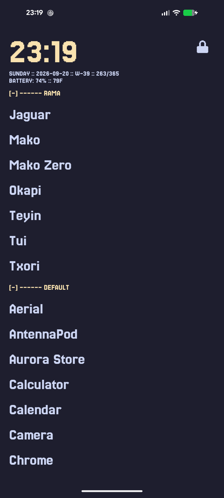
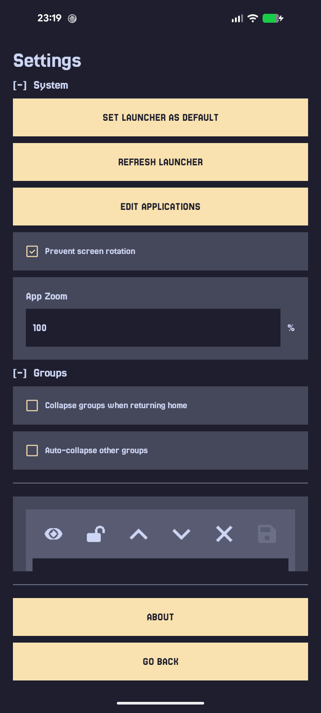
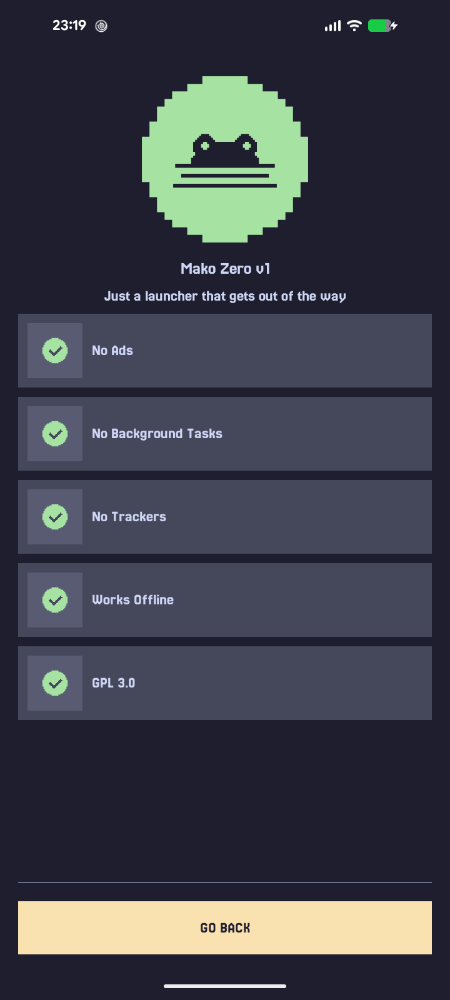

# Mako Zero

**Just a launcher that gets out of the way.**

| Home | Settings | About |
| - | - | - |
|  |  |  |

Designed to support Android API 5 (Android 2.0) through the latest Android versions, with a focus on broad compatibility and long-term stability.

> This app prioritizes stability. It has already reached maturity and is no longer accepting pull requests.

---

## Usage

- Open Settings: Long-press an empty area of the App List.
- Switch lists: Click the clock to alternate between the two lists. The first displays your custom app list; the second organizes apps by permissions.

### Privacy levels: Numbers indicate an app’s privacy level
- (0) Uninstalled: The app is not installed on the device.
- (1) Disabled: The app is installed but disabled.
- (2) Not running: The app is enabled and can run, but is not currently running.
- No number: The app is running.
> Lower numbers indicate a higher level of privacy, from uninstalled (0) to enabled but not running (2).

---

## Links

- Watch the **[Promo](https://youtu.be/u0R5YNajFHY)** for a quick overview.
- Join the **[Discord Community](https://discord.gg/zFFupY8PFE)** for support and updates.

---

## Installation

  
  &nbsp;
  

---

## Acknowledgements

Port of [Mako](https://f-droid.org/en/packages/com.rama.mako/) Inspired by [YAML Launcher](https://f-droid.org/en/packages/eu.ottop.yamlauncher/) and [Pie Launcher](https://f-droid.org/en/packages/de.markusfisch.android.pielauncher/).
